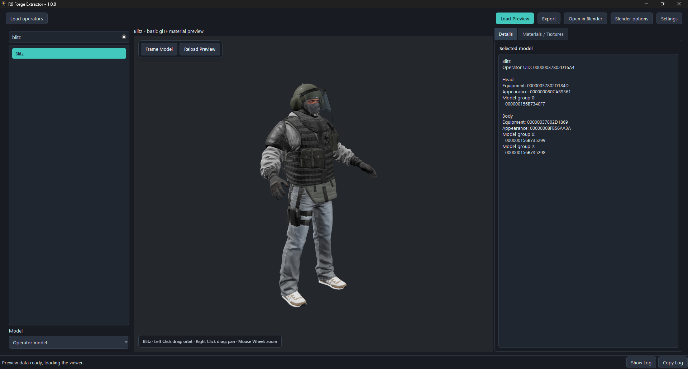

# Rainbow Six Siege Forge Extractor

A Windows tool for browsing Rainbow Six Siege operators and exporting them to Blender.

Includes operator search, asset indexing, export, Blender 4.5 add-on installation and direct Blender launch.



*Desktop interface showing Blitz in the interactive 3D preview.*

[](https://github.com/TrueShadow01/R6-Extractor/releases)
[](https://github.com/TrueShadow01/R6-Extractor/releases)
[](LICENSE)

## Standalone setup

Requires 64-bit Windows, a local Siege installation, a compatible Oodle runtime and Blender 4.5. Python is not required for the standalone build.

1. Extract the entire release ZIP into a folder.
2. Keep `R6ForgeExtractor.exe`, `R6Worker.exe` and `_internal` together.
3. Launch **R6ForgeExtractor.exe**.
4. Choose your Game Folder and Blender 4.5 executable under **Settings**.

## Oodle Installation

If the release includes `oo2core_8_win64.dll` beside
`R6ForgeExtractor.exe`, the application detects it automatically.
No `R6_OODLE_DLL` environment variable is needed.

If the DLL is missing, follow the manual setup below.

### Manual Oodle Setup

You can supply your own `oo2core_8_win64.dll`. Some games using Oodle include this DLL in their installation folders, you may already have a suitable copy in a game you own.

Place the DLL beside `R6ForgeExtractor.exe` or set `R6_OODLE_DLL` to its full path.

For example, launch from PowerShell:

```powershell
$env:R6_OODLE_DLL = "C:\Path\To\oo2core_8_win64.dll"
.\R6ForgeExtractor.exe
```

## Export and open an operator

1. Open the **Settings** menu.
1. Click **Build / Update Asset Index**. Repeat after game updates.
2. Click **Load operators** then search for and select an operator.
3. Click **Export** and choose a destination.
4. Close Blender and click **Install Blender 4.5 add-on** (located in the **Settings** menu) once or again after updating the importer.
5. Optionally enable **Create experimental IK controls** (located in the **Blender Options** menu) then click **Open in Blender** while selecting the exported operator.
6. Save the imported scene as `.blend` if you want to retain its Blender materials and controls.

Exports use:

```text
<destination>/<operator-name>/<body-or-head>/<model-UID>/
```

Export attempts every primary group-0 model and excludes alternate groups. It stops on the first failure and retains completed files. Closing the UI waits for the active indexing, export or installation operation to finish.

The asset database is stored in `output/r6-assets.sqlite` beside the executables. Registry browsing does not require the database.

## Blender import

The add-on imports geometry and applies the existing materials. Ordinary glTF import does not apply the helper's shaders.

To import an existing export manually, use **File → Import → Rainbow Six Siege Operator** in Blender. Select the operator folder containing `body` and `head`.

**Blender 4.5 is required.**

FK posing uses Blender’s Pose Mode. The R6 importer adjusts bone display lengths and enables In Front for easier selection. Head hierarchy and deformation support still vary by operator. 

On supported operators FK import combines the head and body into one armature and selects its head bone. Enter Pose Mode and rotate that bone with R. It may be named R6_Head or retain its imported Head name. 

Unsupported head mappings produce a warning and retain separate armatures.

## Experimental IK Support

*IK support is experimental and optional.*

### Enabling Experimental IK Support

Enable **Create experimental IK controls** in the app before clicking **Open in Blender**. The option is off by default.

On supported rigs, use the controls in Blender's Object Mode:

- Move hand and foot cubes with **G**
- Rotate foot cubes with **R**
- Move knee spheres to steer knee bending
- Move or rotate the larger `R6_HeadControl_…` sphere with **G** or **R**. Use small head translations. The neck does not bend automatically toward the control

Supported head rigs also receive shorter bone displays. Head connection or control creation can fail independently of body IK. 

### Read any Blender warning before posing!

Save the scene as `.blend` to preserve controls and constraints. The manual **File → Import → Rainbow Six Siege Operator** add-on workflow imports models and materials but does **not** automatically create these controls.

## Known limitations

- Experimental IK support varies by operator. Some newer operators support body IK but cannot create head connections or controls.
- Shaders and preview lighting approximate the game appearance. Hair, visor effects and other material features may differ from the game. Operator-specific texture or material issues may remain
- Invalid UV components are replaced with zero and reported in the log. Affected faces may have approximate texture placement
- Export supports default operator appearances as LOD0 glTF. Animation extraction and GLB export are not supported.

## Running from source

Requires 64-bit Python 3.10 or newer. Run from the project directory:

```powershell
py -3 -m pip install -r requirements-gui.txt
py -3 -B app.py
```

For source execution, place Oodle beside `main.py` or use `R6_OODLE_DLL`.

## Preview

Click **Load Preview** to prepare and view the selected operator. The preview includes studio environment reflections.

Shift-click a surface to capture the layers beneath the cursor and open **Materials / Textures**. Shift-click elsewhere to capture a new list or empty space to clear it.

Selection follows mesh geometry rather than texture-alpha pixels. The layer dropdown includes intersected zero-opacity overlays. Selection does not change material opacity.

**Reload Preview** reloads viewer code and cached model files while preserving the camera.

The CLI also supports archive scanning, resumable raw extraction, catalogs and model discovery:

```powershell
py -3 -B main.py -h
py -3 -B -m unittest discover -s tests -v
```

The standalone CLI is available through:

```powershell
.\R6Worker.exe --worker cli -h
```

Tests use synthetic data and do not require game assets or Oodle.

## License and third-party assets

See [LICENSE](LICENSE) for the project license.

Rainbow Six Siege and its assets belong to Ubisoft. Game assets are
not distributed with this application. Bundled third-party components
retain their own licences. See [THIRD_PARTY.md](THIRD_PARTY.md).